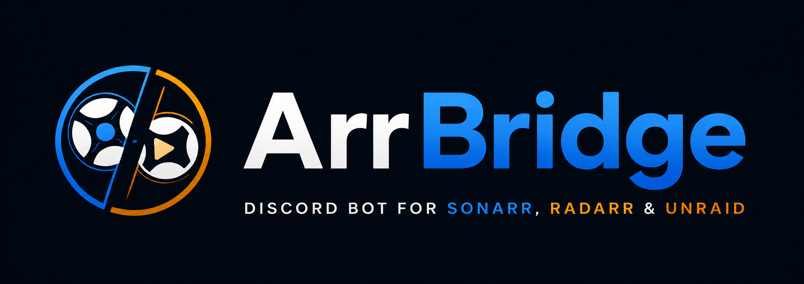

# ArrBridge

Discord bot that lets you search for and add TV shows to Sonarr, and movies to Radarr,
via slash commands.

## Usage

`/addshow query:<title>` — searches Sonarr, lets you pick the matching show from a
dropdown, then pick a root folder and quality profile, then adds it and triggers a
search for missing episodes. The reply keeps updating live with download progress.

`/tvstatus query:<title>` — looks up a show already in your Sonarr library and shows
its current monitored/download status, without needing to add it or open Sonarr.

`/addmovie query:<title>` — same flow as `/addshow`, but searches Radarr and adds a
movie.

`/moviestatus query:<title>` — same as `/tvstatus`, but for a movie already in Radarr.

Separately, a background task sweeps the channel set by `CLEANUP_CHANNEL_ID` every
30 minutes and deletes every message older than `CLEANUP_MAX_AGE_HOURS` (default 6),
so that channel never builds up history. This is not tied to a command.

## Setup

1. **Create a Discord application/bot**: https://discord.com/developers/applications
   - New Application → Bot → reset/copy the token (this is `DISCORD_TOKEN`).
   - Under "Installation" / OAuth2 URL Generator, select scopes `bot` and
     `applications.commands`, give it the `Send Messages` and `Manage Messages`
     permissions (the latter is required for channel cleanup to delete other users'
     messages), and use the generated URL to invite it to your server.
2. **Get your Sonarr and Radarr API keys**: Settings → General → Security → API Key
   in each app.
3. Copy `.env.example` to `.env` and fill in `DISCORD_TOKEN`, `SONARR_URL`,
   `SONARR_API_KEY`, `RADARR_URL`, `RADARR_API_KEY`, `CLEANUP_CHANNEL_ID` (right-click
   the channel in Discord with Developer Mode on → Copy Channel ID).  `GUILD_ID` is
   optional — set it to your server's ID while testing so slash commands register
   instantly instead of waiting up to an hour.
4. Run it:

   ```
   docker compose up -d --build
   ```

`SONARR_URL`/`RADARR_URL` must be reachable from the bot container — use the NAS's
LAN IP (e.g. `http://192.168.1.10:8989`) unless Sonarr/Radarr and this bot share a
Docker network.
